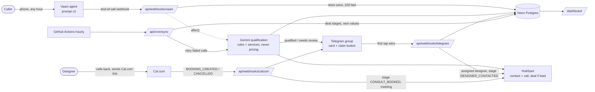

# Aangan Studio: AI voice intake (phase 1, first reach-out)

A Vaani voice agent answers every inbound call. After the call, Gemini judges whether the caller is a
lead worth a designer's time, using the studio's own rubric. Every call is logged in HubSpot. Real leads
become deals and are posted to a Telegram group with one **I'll take it** button. A Cal.com booking moves
the deal forward.

**Metrics:**
- Key metric: time to first response (target: qualified leads called back within an hour)
- Outcome metric: conversion of handled enquiries
- Success metric: revenue from won deals

## Architecture



Everything after the Vaani adapter works on a channel-agnostic `Enquiry` (`lib/enquiry.ts`), so
WhatsApp or a web form can be added later as new adapters.

| Path | What it does |
|---|---|
| `config/qualification_rules.md` | The approved rubric (v1, with a decision log). Fed to Gemini. |
| `agent/vaani_prompt_v2.md` | The voice agent's prompt (current). `v1` is kept for comparison. |
| `agent/vaani_config_notes.md` | Settings to enter in the Vaani dashboard |
| `knowledge/` | services.md, qualified.md, pricing.md (**internal; never sent to any model or message**), September transcripts |
| `lib/` | vaani adapter, pipeline, qualify (Gemini), hubspot, telegram, calcom, claim, price guard |
| `app/api/webhooks/{vaani,telegram,calcom}` | Webhooks |
| `app/api/cron/sync` | Hourly HubSpot stage sync and retry of failed calls |
| `app/dashboard` | Password-protected dashboard and per-call transcript pages |
| `migrations/` | SQL migrations (`npm run migrate`) |
| `tests/` | Unit tests, call simulations, 40-transcript qualification run |

## Hard rules built into the code
- **No price figures.** The agent never states one (`APPROVED_PRICE_BAND_TEXT` is empty by studio
  decision). AI summaries are sanitised. Every Telegram message passes `assertNoPrice` or isn't sent.
  The caller's own budget is stored in Neon but shown in Telegram only as "mentioned / not mentioned".
- **Idempotent.** A retried webhook never creates a second row, HubSpot object or Telegram post: the
  `(channel, external_id)` key is unique, and each step stores its ids before moving on.
- **The system moves deals only** on creation, on claim (DESIGNER_CONTACTED) and on booking
  (CONSULT_BOOKED). Won and lost are set by people.
- **No timers or escalation** in this phase (see Next phases).
- **`DRY_RUN=true`** (the default) skips HubSpot writes and sends Telegram cards only to the admin chat.

## Setup

### 1. Accounts (all free plans except Vaani)

| Service | What you need |
|---|---|
| Gemini | API key from Google AI Studio |
| Neon | A project (Singapore/Mumbai region) and its pooled connection string |
| HubSpot | Free CRM, super-admin user, a private app (see below) |
| Telegram | A bot from @BotFather, the designers' group with the bot added, your private chat with the bot |
| Cal.com | An event type with a **required phone number question**, and its public link |
| GitHub + Vercel | A private repo and a Vercel Hobby project importing it |

### 2. Environment variables
Copy `.env.example` to `.env` and fill it in. Set the same values in Vercel (Project → Settings →
Environment Variables; you can paste the whole file).

| Variable | Notes |
|---|---|
| `GEMINI_API_KEY`, `GEMINI_MODEL` | Default model `gemini-3.8-flash` (2.5-flash isn't offered to new keys) |
| `GEMINI_FALLBACK_MODELS` | Tried in order when the free daily quota of the main model runs out |
| `GEMINI_INPUT_PRICE`, `GEMINI_OUTPUT_PRICE` | USD per 1M tokens, for the cost panel (0 on the free tier) |
| `CALLBACK_WINDOW_BUSINESS_HOURS` / `_AFTER_HOURS` | `within an hour` / `by eleven a.m. on the next working day` |
| `APPROVED_PRICE_BAND_TEXT(_OFFICE)` | Keep empty (no figures) |
| `VAANI_API_KEY`, `VAANI_WEBHOOK_SECRET`, `VAANI_COST_PER_MIN` | Secret goes in the webhook URL or header |
| `DATABASE_URL` | Neon pooled connection string |
| `HUBSPOT_TOKEN`, `HUBSPOT_PORTAL_ID`, `HUBSPOT_PIPELINE_ID`, `HUBSPOT_STAGE_*` | `npm run hubspot-setup` prints these |
| `TELEGRAM_BOT_TOKEN`, `TELEGRAM_CHAT_ID`, `TELEGRAM_ADMIN_CHAT_ID`, `TELEGRAM_WEBHOOK_SECRET`, `SEND_NEEDS_REVIEW` | `npm run telegram-setup -- chats` lists chat ids |
| `CALCOM_WEBHOOK_SECRET`, `CALCOM_LINK` | Secret is pasted into Cal.com's webhook form |
| `APP_BASE_URL` | e.g. `https://aangan-intake.vercel.app` |
| `DASHBOARD_PASSWORD`, `CRON_SECRET` | |
| `FIXED_MONTHLY_COSTS_JSON` | e.g. `{"vaani_plan": 1500}` (INR) |
| `DRY_RUN` | `true` until you've tested end to end |

### 3. Database
```bash
npm install
npm run migrate
```

### 4. HubSpot
1. Settings → Integrations → **Private Apps** → Create (newer accounts: Development → Legacy apps).
   Give it these scopes:
   - `crm.objects.contacts.read/write`
   - `crm.objects.deals.read/write`
   - `crm.schemas.contacts.read/write`
   - `crm.schemas.deals.read/write`
2. Sales → Deals → **Edit pipeline**. Add these stages before Closed won/lost:
   **Qualified (AI)**, **Needs review (AI)**, **Designer contacted**, **Consultation booked**.
3. Run `npm run hubspot-setup`. It checks the scopes, creates the 6 custom deal properties (the free
   CRM allows 10 in total), and prints the `HUBSPOT_*` values for `.env`.

### 5. Deploy on Vercel
1. Push this repo to GitHub (**private**: `knowledge/` holds internal pricing).
2. In Vercel: Add New → Project → import the repo, keeping the defaults (Next.js).
3. Add all env vars and deploy. Set `APP_BASE_URL` to the deployment URL and redeploy.
4. GitHub repo → Settings → Secrets → Actions: add `APP_BASE_URL` and `CRON_SECRET`. This enables
   `.github/workflows/hourly-sync.yml`. Vercel Hobby cron can only run daily, so GitHub Actions runs it instead.

### 6. Telegram
1. Add the bot to the designers' group and send a message there. Also send the bot a private message.
2. Run `npm run telegram-setup -- chats` and put the group id in `TELEGRAM_CHAT_ID` and your private
   chat id in `TELEGRAM_ADMIN_CHAT_ID`.
3. Run `npm run telegram-setup -- webhook`. After this, typing `/chatid` in any chat shows its id.

### 7. Point Vaani at the webhook
Follow `agent/vaani_config_notes.md`. In short:
- Paste the prompt from `npm run render-prompt`.
- Enable recording.
- Set the post-call webhook to `https://<app>/api/webhooks/vaani?token=<VAANI_WEBHOOK_SECRET>`.
- Assign the phone number for inbound calls.

### 8. Cal.com
1. Event type settings → Advanced → **Booking questions**: add a required **Phone number** question.
   **Without it, bookings can only be matched to callers by email**, and phone callers usually have
   no email in HubSpot.
2. Settings → Developer → **Webhooks** → New:
   - Subscriber URL: `https://<app>/api/webhooks/calcom`
   - Triggers: Booking Created, Booking Cancelled, Booking Rescheduled
   - Secret: `CALCOM_WEBHOOK_SECRET`
3. Put the event's public link in `CALCOM_LINK`. It appears on every Telegram card.

(The brief named Calendly, but Calendly webhooks need a paid plan. Cal.com's free plan includes signed
webhooks, so no registration script is needed: the webhook is created in the Cal.com UI above.)

## Testing

| Command | What |
|---|---|
| `npm test` | Unit tests: phone normalisation, after-hours, idempotency and claim race (against Neon), HubSpot dedupe, Telegram formatting, Cal.com signature and matching, no-rupee assertion |
| `npm run simulate` | Gemini plays 32 callers (17 from real phone transcripts, plus edge cases) against the agent prompt. An LLM judge scores each against the checklist. Report: `tests/output/simulations/report_v2.md`. Resumable across days on the free tier. |
| `npm run qualify-all` | Runs all 40 September enquiries through qualification and writes `tests/output/qualification_results.csv` |

### Test with a real call
1. Keep `DRY_RUN=true`.
2. Call the Vaani number and pretend to be a client (e.g. a 3BHK in Baner, done by March).
3. Within about 30 seconds of hanging up, a 🧪 DRY RUN card arrives in your admin chat.
   The call appears at `/dashboard` with its transcript.
4. Tap **I'll take it**. The card shows "Taken by …".
5. Book through the Cal.com link with the same phone number. A 📅 note arrives.
6. When this all works, set `DRY_RUN=false` in Vercel and redeploy. Cards then go to the group and
   HubSpot gets written.

## Next phases (not built)
- **Unclaimed-lead escalation:** a cron step over `handoffs WHERE claimed_at IS NULL AND posted_at < now() - interval '15 minutes'`,
  posting reminders and DMing the owner. `/api/cron/sync` already runs hourly and is the place for it,
  or run it more often from the same GitHub Action.
- **Reassignment:** a second button on the claimed card that clears `claimed_by` (with an audit row)
  and re-posts.
- **Designer routing:** a `designers` table (areas, project types, load), plus a function between
  qualification and `ensureTelegramPost` that picks a designer and mentions them on the card.
- **Other channels:** add a WhatsApp or web-form adapter that produces an `Enquiry`. Everything
  downstream already works per channel (`calls.channel`).
